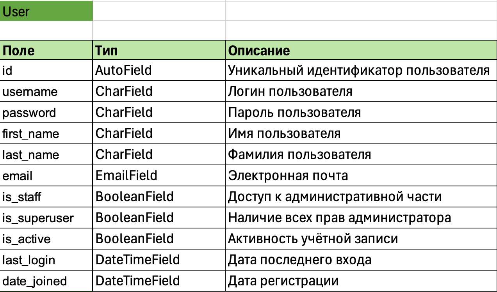
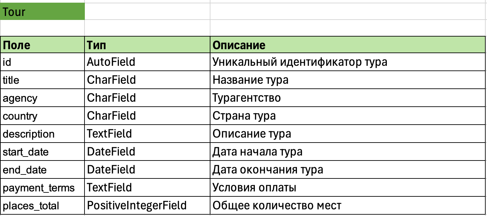
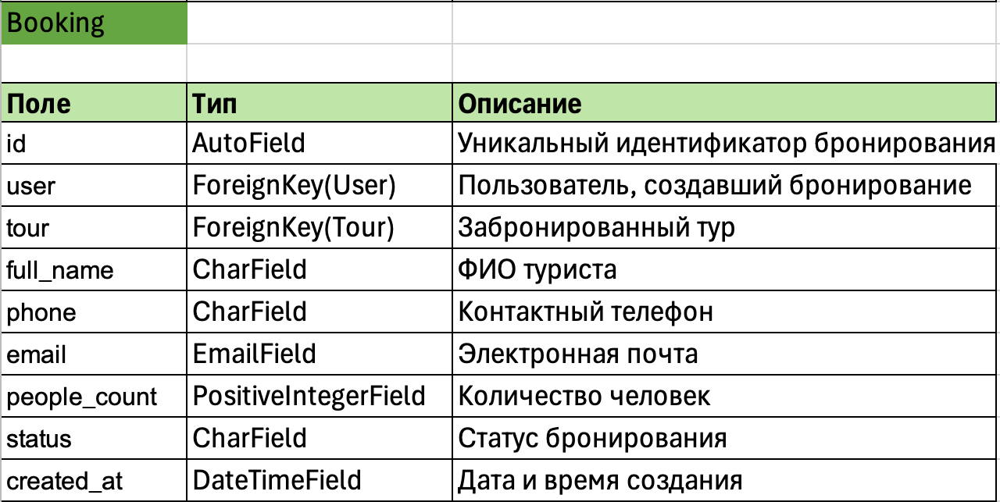
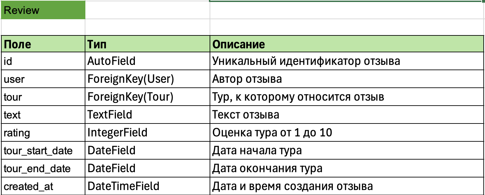
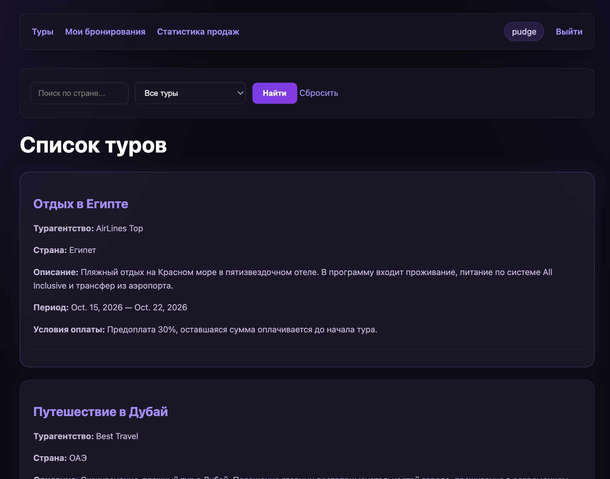
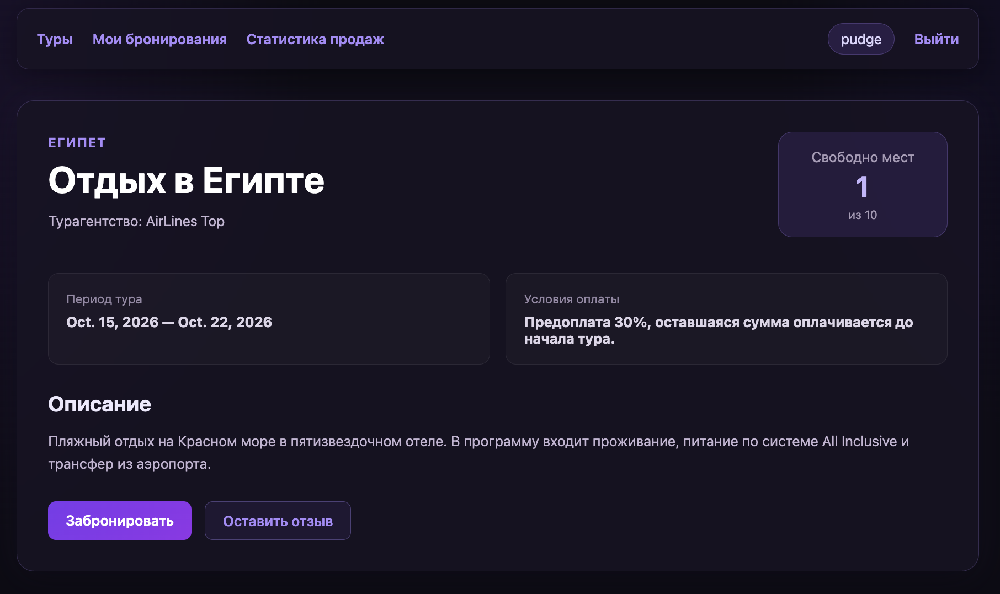
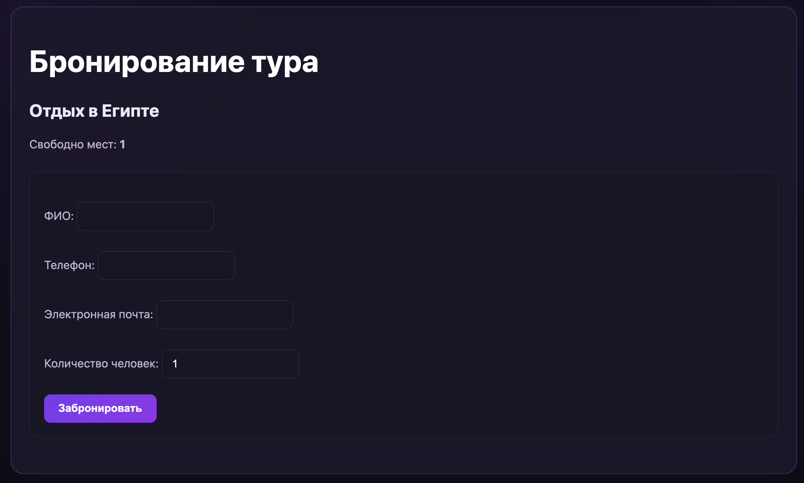
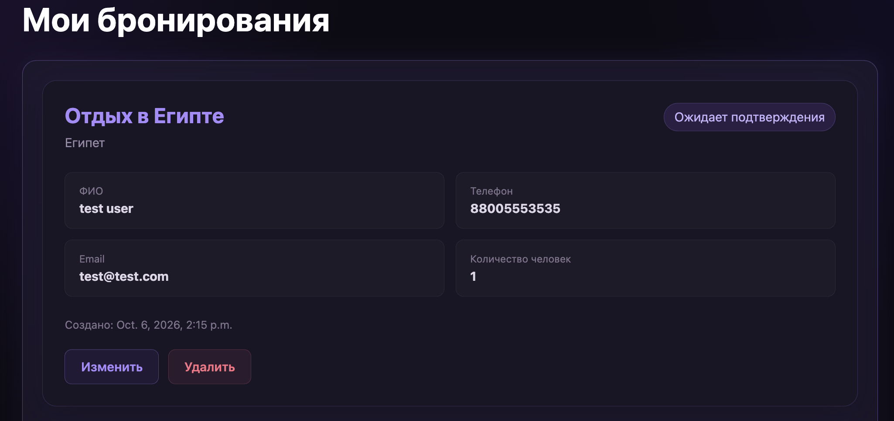
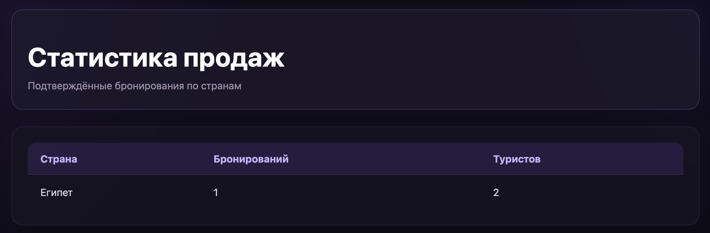
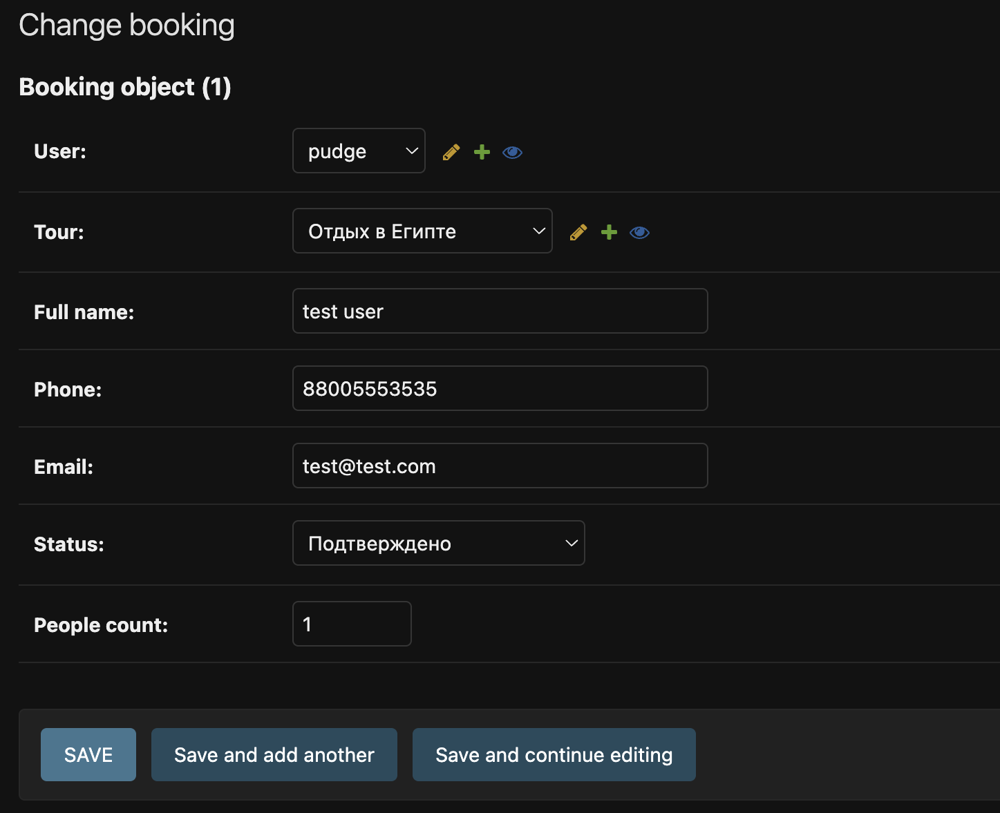

# Лабораторная работа №2

## Цель работы

Овладеть практическими навыками и умениями реализации web-сервисов средствами Django.

## Таблица данных









## Ключевые views

### Просмотр, поиск и фильтрация туров


```python
def tour_list(request):
    tours = Tour.objects.all()

    query = request.GET.get('q', '').strip()
    availability = request.GET.get('availability', '')

    if query:
        tours = tours.filter(country__icontains=query)

    if availability == 'available':
        tours = [
            tour for tour in tours
            if tour.available_places > 0
        ]

    elif availability == 'full':
        tours = [
            tour for tour in tours
            if tour.available_places == 0
        ]

    paginator = Paginator(tours, 2)

    page_number = request.GET.get('page')
    page_obj = paginator.get_page(page_number)

    return render(
        request,
        'main_app/tour_list.html',
        {
            'tours': page_obj,
            'page_obj': page_obj,
            'query': query,
            'availability': availability,
        }
    )
```

### Бронирование тура

```python
@login_required
def book_tour(request, pk):
    tour = get_object_or_404(Tour, pk=pk)

    if request.method == "POST":
        form = BookingForm(request.POST)

        if form.is_valid():
            booking = form.save(commit=False)

            booking.user = request.user
            booking.tour = tour

            if booking.people_count > tour.available_places:
                messages.error(
                    request,
                    f"Недостаточно мест. Свободно: {tour.available_places}"
                )
            else:
                booking.save()

                messages.success(
                    request,
                    "Тур успешно забронирован!"
                )

                return redirect('tour_detail', pk=pk)

    else:
        form = BookingForm()

    return render(
        request,
        'main_app/booking_form.html',
        {
            'form': form,
            'tour': tour
        }
    )
```

### Редактирование бронирования

```python
@login_required
def edit_booking(request, pk):
    booking = get_object_or_404(
        Booking,
        pk=pk,
        user=request.user
    )

    available_for_edit = (
        booking.tour.available_places + booking.people_count
    )

    if request.method == "POST":
        form = BookingForm(
            request.POST,
            instance=booking
        )

        if form.is_valid():
            updated_booking = form.save(commit=False)

            if updated_booking.people_count > available_for_edit:
                messages.error(
                    request,
                    f"Недостаточно мест. Максимально доступно: {available_for_edit}"
                )
            else:
                updated_booking.save()

                messages.success(
                    request,
                    "Бронирование успешно изменено!"
                )

                return redirect("my_bookings")

    else:
        form = BookingForm(instance=booking)

    return render(
        request,
        "main_app/edit_booking.html",
        {
            "form": form,
            "booking": booking,
            "available_for_edit": available_for_edit,
        }
    )
```

### Добавление отзыва

```python
@login_required
def add_review(request, pk):
    tour = get_object_or_404(Tour, pk=pk)

    if request.method == "POST":
        form = ReviewForm(request.POST)

        if form.is_valid():
            review = form.save(commit=False)

            review.user = request.user
            review.tour = tour

            review.save()

            messages.success(
                request,
                "Отзыв успешно добавлен!"
            )

            return redirect("tour_detail", pk=pk)

    else:
        form = ReviewForm()

    return render(
        request,
        "main_app/review_form.html",
        {
            "form": form,
            "tour": tour
        }
    )
```

### Статистика продаж по странам

```python
@user_passes_test(lambda user: user.is_staff)
def sales_by_country(request):
    sales = (
        Booking.objects
        .filter(status='confirmed')
        .values('tour__country')
        .annotate(
            bookings_count=Count('id'),
            people_count=Sum('people_count')
        )
        .order_by('tour__country')
    )

    return render(
        request,
        'main_app/sales_by_country.html',
        {'sales': sales}
    )
```

## Шаблоны

## Ключевые шаблоны

### Список туров

Шаблон `tour_list.html` отображает список доступных туров, навигацию в зависимости от роли пользователя, форму поиска и фильтрации, а также пагинацию.

```html
<header class="navbar">
    <div class="nav-links">
        <a href="">Туры</a>

        
            <a href="">
                Мои бронирования
            </a>
        

        
            <a href="">
                Статистика продаж
            </a>
        
    </div>

    <div class="nav-user">
        
            <span>{{ user.username }}</span>
            <a href="">Выйти</a>
        
            <a href="">Войти</a>
            <a href="">Регистрация</a>
        
    </div>
</header>
```

Навигация изменяется в зависимости от состояния пользователя. Авторизованному пользователю доступен раздел его бронирований, а сотруднику с признаком `is_staff` дополнительно отображается ссылка на статистику продаж.

```html
<form method="get">
    <input
        type="text"
        name="q"
        placeholder="Поиск по стране..."
        value="{{ query }}"
    >

    <select name="availability">
        <option value="">Все туры</option>
        <option value="available">Есть свободные места</option>
        <option value="full">Мест нет</option>
    </select>

    <button type="submit">Найти</button>

    <a href="">
        Сбросить
    </a>
</form>
```

Форма передаёт параметры методом `GET` и позволяет выполнять поиск туров по стране и фильтрацию по наличию свободных мест.

```html

    <div>
        <h2>
            <a href="">
                {{ tour.title }}
            </a>
        </h2>

        <p><b>Турагентство:</b> {{ tour.agency }}</p>
        <p><b>Страна:</b> {{ tour.country }}</p>
        <p><b>Описание:</b> {{ tour.description }}</p>

        <p>
            <b>Период:</b>
            {{ tour.start_date }} — {{ tour.end_date }}
        </p>

        <p>
            <b>Условия оплаты:</b>
            {{ tour.payment_terms }}
        </p>
    </div>


    <p>Туров пока нет.</p>

```

Для каждого тура выводится основная информация и ссылка на страницу с подробным описанием тура.

```html

    <a href="?page={{ page_obj.previous_page_number }}&q={{ query }}&availability={{ availability }}">
        Назад
    </a>


<span>
    Страница {{ page_obj.number }}
    из {{ page_obj.paginator.num_pages }}
</span>


    <a href="?page={{ page_obj.next_page_number }}&q={{ query }}&availability={{ availability }}">
        Далее
    </a>

```

При переходе между страницами сохраняются введённый поисковый запрос и выбранный фильтр.

### Страница конкретного тура

Шаблон `tour_detail.html` отображает подробную информацию о выбранном туре, количество свободных мест, действия для бронирования и добавления отзыва, а также список отзывов пользователей.

```html
<div class="tour-detail-header">
    <div>
        <p class="tour-country">
            {{ tour.country }}
        </p>

        <h1>{{ tour.title }}</h1>

        <p class="tour-agency">
            Турагентство: {{ tour.agency }}
        </p>
    </div>

    <div class="places-box">
        <span>Свободно мест</span>
        <strong>{{ tour.available_places }}</strong>
        <small>из {{ tour.places_total }}</small>
    </div>
</div>
```

В верхней части страницы отображаются страна, название тура, турагентство и информация о количестве свободных мест.

```html
<div class="tour-info">

    <div class="tour-info-block">
        <span>Период тура</span>

        <strong>
            {{ tour.start_date }} — {{ tour.end_date }}
        </strong>
    </div>

    <div class="tour-info-block">
        <span>Условия оплаты</span>

        <strong>
            {{ tour.payment_terms }}
        </strong>
    </div>

</div>

<div class="tour-description">
    <h2>Описание</h2>

    <p>
        {{ tour.description }}
    </p>
</div>
```

Отдельными блоками выводятся даты проведения тура, условия оплаты и его описание.

```html


    
        <a
            class="primary-link"
            href=""
        >
            Забронировать
        </a>
    
        <span class="no-places">
            Свободных мест нет
        </span>
    

    <a
        class="secondary-link"
        href=""
    >
        Оставить отзыв
    </a>



    <a
        class="primary-link"
        href=""
    >
        Войти для бронирования
    </a>


```

Возможность бронирования зависит от авторизации пользователя и наличия свободных мест. Неавторизованному пользователю предлагается выполнить вход в систему.

```html


    <div class="review-card">

        <div class="review-header">
            <strong>
                {{ review.user.username }}
            </strong>

            <span class="rating">
                {{ review.rating }}/10
            </span>
        </div>

        <p>
            {{ review.text }}
        </p>

        <small>
            Тур:
            {{ review.tour_start_date }}
            —
            {{ review.tour_end_date }}
        </small>

    </div>



    <p>
        Отзывов пока нет.
    </p>


```

Для каждого отзыва выводятся имя пользователя, оценка, текст отзыва и даты тура.

### Мои бронирования

Шаблон `my_bookings.html` отображает все бронирования текущего пользователя, их статус, контактные данные и позволяет редактировать или удалять бронирование.

```html


    <div class="booking-card">

        <div class="booking-header">
            <div>
                <h2>{{ booking.tour.title }}</h2>

                <p class="booking-country">
                    {{ booking.tour.country }}
                </p>
            </div>

            <span class="booking-status">
                {{ booking.get_status_display }}
            </span>
        </div>

        <div class="booking-info">

            <div>
                <span>ФИО</span>
                <strong>{{ booking.full_name }}</strong>
            </div>

            <div>
                <span>Телефон</span>
                <strong>{{ booking.phone }}</strong>
            </div>

            <div>
                <span>Email</span>
                <strong>{{ booking.email }}</strong>
            </div>

            <div>
                <span>Количество человек</span>
                <strong>{{ booking.people_count }}</strong>
            </div>

        </div>
```

Для каждого бронирования выводятся название и страна тура, текущий статус, контактные данные и количество туристов.

```html
<div class="booking-actions">

    <a
        class="secondary-link"
        href=""
    >
        Изменить
    </a>

    <a
        class="delete-link"
        href=""
    >
        Удалить
    </a>

</div>
```

Пользователь может перейти к редактированию своего бронирования или удалить его.

```html


    <div class="empty-bookings">
        <h2>Бронирований пока нет</h2>

        <p>
            Выберите подходящий тур и забронируйте его.
        </p>

        <a
            class="primary-link"
            href=""
        >
            Посмотреть туры
        </a>
    </div>


```

Если бронирований нет, пользователю выводится соответствующее сообщение и ссылка для перехода к списку туров.

### Статистика продаж

Шаблон `sales_by_country.html` используется для отображения статистики подтверждённых бронирований по странам. Страница доступна только сотрудникам.

```html
<div class="stats-header">
    <h1>Статистика продаж</h1>

    <p>
        Подтверждённые бронирования по странам
    </p>
</div>

<div class="stats-card">

    <table class="stats-table">
        <thead>
            <tr>
                <th>Страна</th>
                <th>Бронирований</th>
                <th>Туристов</th>
            </tr>
        </thead>

        <tbody>

        
            <tr>
                <td>{{ sale.tour__country }}</td>
                <td>{{ sale.bookings_count }}</td>
                <td>{{ sale.people_count }}</td>
            </tr>

        
            <tr>
                <td colspan="3">
                    Подтверждённых бронирований пока нет.
                </td>
            </tr>
        

        </tbody>
    </table>

</div>
```

Для каждой страны выводится количество подтверждённых бронирований и общее количество туристов. Данные передаются в шаблон из `sales_by_country` view, где бронирования предварительно фильтруются по статусу `confirmed` и группируются по странам.

Если подтверждённых бронирований нет, вместо строк статистики выводится соответствующее сообщение.

## Скриншоты работы приложения

Рисунок 1 — Главная страница со списком туров, поиском, фильтрацией и пагинацией.


Рисунок 2 — Страница с подробной информацией о выбранном туре.


Рисунок 3 — Форма создания бронирования тура.


Рисунок 4 — Страница управления бронированиями пользователя.


Рисунок 5 — Статистика подтверждённых бронирований по странам.


Рисунок 6 — Управление статусом бронирования через административную панель Django.


## Вывод

В ходе лабораторной работы было разработано веб-приложение туристической фирмы на Django. Были реализованы просмотр и поиск туров, бронирование, работа с отзывами, управление бронированиями, пагинация и разграничение прав пользователей.

Также была настроена административная панель для подтверждения бронирований и реализована статистика продаж по странам. В ходе выполнения работы были закреплены навыки работы с моделями, views, шаблонами, формами и авторизацией Django.